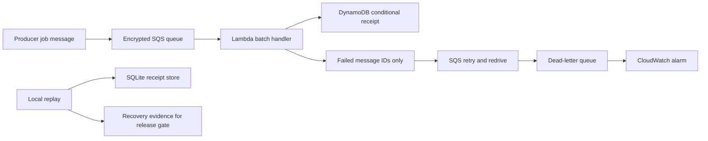

# AWS Event Recovery Platform

Process standard SQS batches with partial failures, idempotent DynamoDB receipts, and a dead-letter queue. Run the same batch logic locally with SQLite.

## Business problem

Retrying a whole batch because one message failed can repeat successful work. Discarding all repeats by job ID can also hide a producer bug when the ID is reused for different input.

## Architecture



## Design and tools

A conditional write creates one receipt per job. If a duplicate arrives, a consistent read distinguishes an exact retry from a conflicting payload. The batch handler returns only failed message IDs. The drill retries those IDs until the configured receive limit and compares persisted receipts, attempts, and dead-letter IDs to expected evidence.

**Stack** · AWS Lambda, Amazon SQS, DynamoDB, CloudWatch, IAM, Terraform, Python, SQLite

## Run the demo

Use Python 3.9 or later and Make from the repository root.

```sh
make verify
python3 drill.py examples/mixed-batch.json
terraform -chdir=infra init -backend=false
terraform -chdir=infra validate
```

## Deployment

Use a sandbox AWS account and an authorized IAM role. Run `terraform -chdir=infra plan` to review the resources and cost before deciding whether to apply. The module provisions encrypted queues, source-specific redrive, a Lambda event mapping with partial batch responses, DynamoDB point-in-time recovery, and a CloudWatch alarm. The alarm has no delivery action configured.

## Verification

Four tests passed. The fixture stored one receipt, accepted an identical retry, and sent two invalid or conflicting records to the simulated DLQ after three receives. Terraform format and validate passed with the locked AWS and archive providers.

## Operating limits

The local drill simulates queue delivery and redrive. Terraform validated without applying resources. AWS IAM permissions, Lambda execution, and CloudWatch delivery were outside the local test.

[Architecture](docs/ARCHITECTURE.md) · [Case study](docs/CASE_STUDY.md) · [Troubleshooting](docs/TROUBLESHOOTING.md) · [Runbook](docs/RUNBOOK.md)

The [Release Evidence Pipeline](https://github.com/Klokesh493/release-evidence-pipeline) consumes this project's report in its integration demo.

[AWS partial batch response documentation](https://docs.aws.amazon.com/lambda/latest/dg/services-sqs-errorhandling.html)
