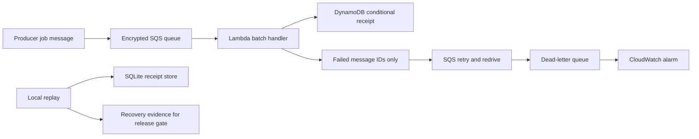

# Architecture

A conditional write creates one receipt per job. If a duplicate arrives, a consistent read distinguishes an exact retry from a conflicting payload. The batch handler returns only failed message IDs. The drill retries those IDs until the configured receive limit and compares persisted receipts, attempts, and dead-letter IDs to expected evidence.

Use a sandbox AWS account and an authorized IAM role. Run `terraform -chdir=infra plan` to review the resources and cost before deciding whether to apply. The module provisions encrypted queues, source-specific redrive, a Lambda event mapping with partial batch responses, DynamoDB point-in-time recovery, and a CloudWatch alarm. The alarm has no delivery action configured.
